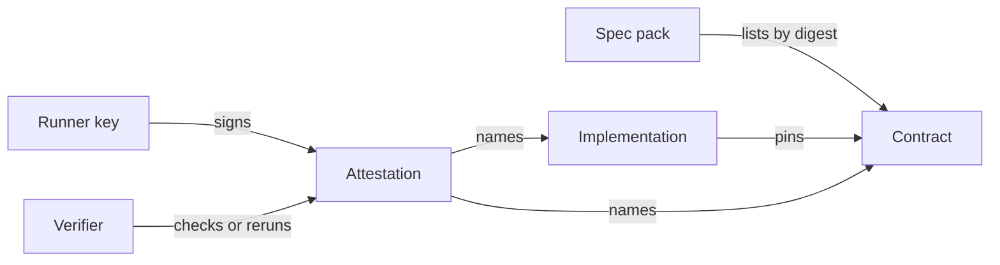

# Concepts

## Contract

A **contract** is a versioned, content-addressed statement of what a piece of software must do. In the first vertical, a capability contract is a directory:

| File | Role |
| --- | --- |
| `symbolon.toml` | Manifest: id, version, prose description, entrypoint, what the implementation may touch, spec budget |
| `schema.py` and `schema/*.json` | The interface: pydantic `Input` and `Output` models, and the language-neutral JSON Schema generated from them |
| `examples.jsonl` | Concrete cases: an input and either the exact output or the error it must raise |
| `properties.py` | Hypothesis properties that must hold for generated inputs |
| `reference/impl.py` | Optional reference implementation, used only as an oracle during validation |

The prose description and the checks are two halves of one spec. The checks are what an implementation is held to; the description tells a builder, human or AI, what the checks mean.

A contract is **valid** only if its spec is not vacuous: its properties must reject an implementation that always raises and one that always returns a constant. A spec that cannot tell those apart from a real implementation is not a spec.

## Digest

A contract's identity is the SHA-256 **digest** of its files, nothing else. Timestamps and permissions are excluded, so the same contract has the same digest on every machine. `namespace/name@version` is only an alias. Any change to a contract's files changes its digest, and any change to its schema or spec should bump its version.

Implementations have digests too, computed the same way over their source, manifest and lockfile. The same code with different dependency pins is a different implementation.

## Implementation

An **implementation** is any code that claims to satisfy a contract. It is pinned to one contract digest in its `symbolon-impl.toml`. It exchanges only plain JSON values, so any tool or model can write one without importing Symbolon:

- **Python:** a function, normally `run(input: dict) -> dict`, that raises `ValueError` on invalid input.
- **Any other language:** a program that reads one JSON input per line on stdin and writes `{"output": ...}` or `{"error": {...}}` per line.

Implementations are disposable. The contract and the evidence about it are what last.

## Attestation

An **attestation** is signed evidence that one implementation passed or failed one contract's spec, in a recorded sandbox and environment, on a given runner. It is an [in-toto](https://in-toto.io/) Statement with the Test Result predicate, in a DSSE envelope signed with the runner's Ed25519 key. It names the contract digest, the implementation digest and an environment digest, and lists every check by name.

Two separate questions apply to any attestation:

- **Is it genuine?** The signature verifies against the embedded public key.
- **Do I trust it?** The key is one you accept, passed with `--trust`. Better still, `verify --rerun` reproduces the run locally.

## Spec pack

A **spec pack** is a product-level contract, packaged so a builder can rebuild the product in their own stack. It holds:

- `BRIEF.md`: purpose, non-goals, priorities, and who resolves gaps.
- `PRODUCT.md` (optional): the whole product a build delivers, its shape, surfaces and flows. A pack with it is a product pack, built as the product with the components as its core.
- `assumptions/`: facts about the world a builder may rely on.
- `obligations.toml`: the decisions a build must keep, each `decided`, `default` or `open`, and each tied to the checks that pin it down.
- `components/`: ordinary capability contracts.

Packs are meant to be minimal. They don't spell out what any good builder would do anyway; they hold the points where good builders would choose differently and the publisher would reject one choice. Most obligations are found by **replication**: give the pack to independent builders, compare their builds, and turn each disagreement into an obligation with a check. The [lightkone pilot](lightkone-pilot.md) is the first worked example.

## How they fit

